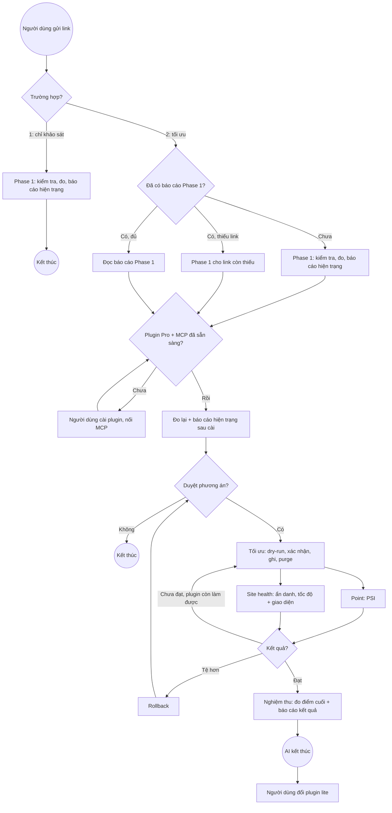

# Phân tích quy trình tối ưu — Phase 1 và Phase 2

> **Lưu ý khi đọc:** Số liệu trong tài liệu này lấy từ lần chạy frozen-top.io.vn ngày 2026-10-15 – 16, chỉ để giải thích lý do thay đổi quy trình. Không dùng làm mốc so sánh, ngưỡng đạt hay kết quả mong đợi cho site khác, hoặc cho lần chạy khác của chính frozen-top.io.vn (cấu hình plugin đã đổi từ đó). Tiêu chí và quy trình hiện hành: `README.md` mục **Quy trình**.

Nguồn: `Phase 1.png`, `Phase 2.png` trong thư mục này. Đối chiếu với quy trình agent trong `audit-website/README.md` (mục **Quy trình**) **trước khi sửa ngày 2026-10-16**, và lần chạy thật trên frozen-top.io.vn ngày 2026-10-15 – 16. Số liệu lần chạy đó trích ngay trong tài liệu này; thư mục báo cáo của lần chạy không còn trong `reports/`. Quy trình hiện hành: `README.md` mục **Quy trình**.

## 1. Sơ đồ hiện tại

### Phase 1

Bắt đầu → **Kiểm tra PageSpeed point và tốc độ load website** → **Báo cáo hiện trạng** → Kết thúc.

### Phase 2

Bắt đầu → **Cài plugin tối ưu PageSpeed Pro** (người dùng cài) → **Tối ưu** → **Double check site** → song song **Point** và **Site health** → **Báo cáo nghiệm thu** → **Đổi plugin lite** (người dùng cài) → Kết thúc.

### Đã chốt (2026-10-16)

| Mục | Định nghĩa |
| --- | --- |
| Site health | Kiểm tra tốc độ và giao diện website khi xem bằng cửa sổ ẩn danh: có lỗi hay không |
| Báo cáo nghiệm thu | Lần đo điểm cuối cùng, sau khi tối ưu đã đạt yêu cầu. Chính là báo cáo kết quả sau tối ưu |
| Đổi plugin lite | Bắt buộc. Người dùng làm. Bản lite chỉ ẩn các option (chi tiết cập nhật sau). AI không làm bước này |
| Điểm kết thúc của AI | Sau khi tạo báo cáo kết quả sau tối ưu (nghiệm thu) |
| Trường hợp 1 | Chỉ Phase 1 |
| Trường hợp 2 | Đã có báo cáo Phase 1 → dùng lại thông tin, làm tiếp Phase 2. Chưa có → làm từ Phase 1 đến Phase 2 |
| Mốc "trước" của nghiệm thu | Số đo lại sau khi cài plugin (3.2; README bước 2b mục 3). Số Phase 1 ghi để tham khảo. Phase 1 vừa đo trong cùng phiên với MCP đúng miền thì dùng luôn số đó, không đo lại |

## 2. Đối chiếu với quy trình agent

| Sơ đồ | Quy trình agent (README) | Khớp |
| --- | --- | --- |
| Phase 1 | Trường hợp 1: site chưa cài plugin → đo PSI và tải thật, báo cáo hiện trạng (`.md` + Word), kết thúc | Khớp |
| Phase 2 — Cài plugin | Người dùng cài plugin, bật MCP, nối agent (mục **Kết nối**), khởi động lại agent | Thiếu bước nối MCP |
| — | Bước 0 kiểm tra trước, bước 1 đo lại, bước 2 báo cáo hiện trạng sau khi cài plugin | **Thiếu trên sơ đồ** |
| — | Hỏi link nào cần tối ưu, dòng `proposed` nào được duyệt | **Thiếu trên sơ đồ** |
| Tối ưu | Bước 3: dry-run → người dùng xác nhận diff → ghi → purge → mở HTML kiểm tra | Khớp một phần (thiếu dry-run và duyệt) |
| Double check site → Point, Site health | Bước 4: đo lại PSI và tải thật, đánh giá 4 tiêu chí mẫu Word, điều kiện "điểm mobile và CLS không tệ hơn" | Khớp một phần (thiếu nhánh chưa đạt và rollback) |
| Báo cáo nghiệm thu | Báo cáo kết quả `.md` + Word + `Đề xuất bổ sung`. AI kết thúc ở đây | Khớp |
| Đổi plugin lite | Không có trong README | Việc của người dùng, sau khi AI kết thúc |

## 3. Các điểm cần bổ sung

### 3.1. Phase 1 không có điểm nối sang Phase 2

Phase 1 kết thúc ngay sau báo cáo. Nên có cổng quyết định **"Khách đồng ý tối ưu?"**: có → Phase 2, không → kết thúc. Báo cáo hiện trạng Phase 1 là đầu vào của Phase 2, không phải mốc "trước" để so với nghiệm thu (xem 3.2).

### 3.2. Thiếu bước đo lại sau khi cài plugin — quan trọng nhất

Cài plugin đã làm thay đổi site trước khi agent tối ưu gì. Trên frozen-top.io.vn:

| Thời điểm | PSI mobile | Ảnh hero |
| --- | --- | --- |
| Phase 1, chưa cài plugin | 90 (LCP ảnh hero 3,1 s) | `src` thật |
| Ngay sau cài plugin, chưa tối ưu | 93 (LCP lấy chữ, 2,3 s) | Bị plugin lazyload: `src` SVG giữ chỗ, khách tải bản gốc 1,99 MB sau mốc Load |

Điểm tăng vì PSI không thấy ảnh, không phải vì nhanh hơn. Nếu so nghiệm thu với số Phase 1, kết quả bị lệch. Cần thêm sau bước cài: **Kiểm tra kết nối MCP → Đo lại → Báo cáo hiện trạng sau cài plugin**. Đã chốt: bảng trước/sau của nghiệm thu dùng số này làm "trước", số Phase 1 ghi để tham khảo.

### 3.3. Thiếu bước duyệt trước khi tối ưu

Sơ đồ đi thẳng từ cài plugin sang tối ưu. Quy trình agent có hai điểm dừng bắt buộc:

1. Người dùng chọn link cần tối ưu (cột **Tối ưu** trong `Do.md`) và dòng `proposed` được duyệt. Chỉ tối ưu trang được yêu cầu; option toàn site chỉ đổi khi người dùng yêu cầu rõ.
2. Mỗi lần ghi: dry-run → người dùng xác nhận diff → mới ghi.

Nên vẽ thành một cổng **"Duyệt phương án?"** trước **Tối ưu**.

### 3.4. Double check không có nhánh "chưa đạt"

Nghiệm thu chỉ diễn ra khi tối ưu đã đạt yêu cầu, nên trước nghiệm thu phải có cổng kiểm tra. Sơ đồ hiện chỉ có một đường đi tiếp. Thực tế frozen-top cần ba vòng:

| Vòng | Việc | Kết quả |
| --- | --- | --- |
| 1 | Ghi VPI ảnh hero | PSI mobile 93 → 88, khách thật không nhận VPI (Guest Mode tải lại trang) → **rollback** |
| 2 | Ghi lại VPI + 2 key `_client` | PSI mobile 88, tải thật mobile Load 811 ms → còn việc |
| 3 | Critical CSS + ảnh mobile 300 px | PSI mobile 96, ảnh mobile hơi mờ |

Cần cổng quyết định sau Double check với ba nhánh:

- **Đạt** → Nghiệm thu (đo điểm cuối, báo cáo kết quả).
- **Chưa đạt, plugin còn làm được** → hỏi người dùng → quay lại Tối ưu.
- **Tệ hơn trước** (điểm mobile hoặc CLS) → Rollback (dry-run, xác nhận) → quay lại Tối ưu.

### 3.5. Point chưa đủ — Site health là kiểm tra ẩn danh

Point (điểm PSI) có thể đánh lừa:

- Điểm tăng có thể do PSI không nạp ảnh (3.2) hoặc do hạ chất lượng ảnh (vòng 3: ảnh 300 px cho khung 651 px).
- Đánh giá sau tối ưu frozen-top: PSI mobile 93 → 96, nhưng tải thật Load mobile 243 → 371 ms và khách vẫn tải ảnh gốc 1,94 MB.

Site health = mở trang bằng **cửa sổ ẩn danh** (không cookie, như khách mới) và kiểm tra tốc độ, giao diện:

| Kiểm tra | Cách làm | Lỗi khi |
| --- | --- | --- |
| Tốc độ load | Ẩn danh → DevTools → Network → tải trang, Desktop và Mobile (giả lập thiết bị). Agent: `measure-run.js` phiên mới | Trung vị 3 lần đo: Desktop > 2 s, Mobile > 3 s, hoặc chậm hơn mốc trước quá ngưỡng nhiễu (200 ms) |
| Cache | Header `x-litespeed-cache` | Không phải `hit` |
| Ảnh màn hình đầu | Xem ngay khi tải | Khung trống, ảnh hiện sau vài giây, ảnh mờ (size nhỏ hơn khung) |
| Bố cục | Xem khi tải và sau tải | Giật (CLS > 0,25), mất style, chữ không có nền, vỡ khung |
| Lỗi script | DevTools → Console | Lỗi đỏ mới xuất hiện sau tối ưu, menu/nút không bấm được |
| Sau khi trang tự tải lại | LiteSpeed Guest Mode tải lại trang ở lượt đầu; xem bản sau tải lại | Bản sau tải lại khác giao diện hoặc mất tối ưu (preload, Critical CSS) |
| Bên thứ ba | Network, lọc theo tên miền ngoài | Script ngoài chặn hiển thị |

Lưu ý: cửa sổ ẩn danh mở lần đầu nhận bản guest, rồi LiteSpeed tải lại thành bản khách thường. Cả hai bản đều phải không lỗi. Muốn kiểm tra lại từ đầu thì đóng hết cửa sổ ẩn danh và mở cửa sổ mới.

### 3.6. Báo cáo nghiệm thu nên tách việc của người dùng

Nút thắt chính trên frozen-top nằm ngoài plugin: ảnh hero PNG 1,99 MB (cần WebP, chọn size trong Bricks), 11 file font Google. Báo cáo nghiệm thu nên luôn kèm `Đề xuất bổ sung` (A: người dùng làm, B: AI làm khi duyệt, C: không đề xuất). Người dùng làm phần A xong thì có thể mở một vòng đo lại mới.

### 3.7. Đổi plugin lite — việc của người dùng, sau khi AI kết thúc

AI kết thúc sau báo cáo nghiệm thu. Bản lite chỉ ẩn các option; chi tiết sẽ cập nhật sau. Trong sơ đồ nên ghi rõ bước này là của người dùng và nằm ngoài phạm vi AI (đã có chú thích "Người dùng cài").

Khi có chi tiết bản lite, nên bổ sung một dòng hướng dẫn cho người dùng: sau khi đổi, purge trang đã tối ưu và mở ẩn danh kiểm tra như 3.5, để chắc tối ưu vẫn còn.

## 4. Quy trình đề xuất — hai trường hợp

| Trường hợp | Gồm | Khi nào |
| --- | --- | --- |
| **1** | Chỉ Phase 1 | Khách chỉ cần khảo sát hiện trạng, không tối ưu |
| **2** | Phase 2, có Phase 1 đi trước | Khách cần tối ưu. Đã có báo cáo Phase 1 → dùng lại, làm tiếp Phase 2. Chưa có → làm Phase 1 rồi Phase 2 |

Người dùng nói rõ trường hợp khi gửi link. Không nói thì agent hỏi lại, không đoán.

### Trường hợp 1 — Chỉ Phase 1

1. Bắt đầu: người dùng gửi link (`Do.md` mục 1, 2).
2. Kiểm tra trước: plugin đã cài chưa, MCP nối đúng miền chưa (để ghi vào báo cáo và chọn nguồn đo).
3. Đo PSI và tốc độ load thật.
4. Báo cáo hiện trạng (`.md` + Word) trong `reports/YYYY-MM-DD-ten-mien/`.
5. **Kết thúc.** Không tối ưu, không ghi gì lên site.

### Trường hợp 2 — Phase 1 (nếu chưa có) rồi Phase 2

**Bước kiểm tra: đã có báo cáo Phase 1 chưa?**

Tìm trong `reports/` thư mục `YYYY-MM-DD-ten-mien/` (phần sau ngày trùng đúng tên miền, không khớp theo đuôi) có file `.md` hiện trạng và `Báo cáo - Hiện trạng website trước khi tối ưu - ten-mien.docx`.

| Kết quả | Việc làm |
| --- | --- |
| Có báo cáo, có đủ các link trong `Do.md` | Đọc báo cáo: điểm, tải thật, audit, `type`/`source_id`, theme. Ghi tiếp vào cùng thư mục báo cáo đó. Sang Phase 2 |
| Có báo cáo nhưng thiếu một số link | Làm Phase 1 cho các link còn thiếu, ghi thêm vào cùng file. Rồi sang Phase 2 |
| Chưa có báo cáo | Làm Phase 1 từ đầu (bước 1–4 của trường hợp 1), rồi sang Phase 2 |

**Phase 2 — Tối ưu và nghiệm thu**

1. Plugin PageSpeed Pro: chưa cài → người dùng cài, bật MCP, nối agent, khởi động lại agent. Agent dừng chờ. Đã cài → bỏ qua.
2. Agent kiểm tra kết nối (`vnx_get_status`): `site_url` trùng miền, plugin bật, MCP bật.
3. **Đo lại và báo cáo hiện trạng sau cài plugin**, ghi thêm vào file `.md` của Phase 1 (mục "Kiểm tra lại"). Đo 3 lần, lấy trung vị. Đây là mốc "trước" của nghiệm thu (3.2). Số Phase 1 giữ để tham khảo.
4. Cổng: **Duyệt phương án?** Người dùng chọn link (cột **Tối ưu**) và dòng `proposed`. Không duyệt → kết thúc.
5. Tối ưu: dry-run → xác nhận → ghi → purge → mở HTML kiểm tra.
6. Double check, song song:
   - Point: PSI mobile và desktop, 3 lần lấy trung vị.
   - Site health: tốc độ (3 lần, trung vị) và giao diện ở cửa sổ ẩn danh (bảng 3.5).
   - Chỉ so với mốc "trước" của cùng URL, cùng thiết bị, cùng nguồn đo. Chênh lệch trong ngưỡng nhiễu (điểm ≤ 3, Load/LCP/FCP ≤ 200 ms, CLS ≤ 0,02) coi là không đổi.
7. Cổng: **Kết quả?**
   - Tệ hơn (quá ngưỡng nhiễu, hoặc Site health có lỗi mới) → rollback (dry-run, xác nhận) → bước 4.
   - Chưa đạt, plugin còn làm được → hỏi → bước 5.
   - Đạt, hoặc plugin hết việc → bước 8.
8. Nghiệm thu: đo điểm cuối (3 lần, trung vị), báo cáo kết quả sau tối ưu (`.md` + Word) + `Đề xuất bổ sung`. **AI kết thúc.**
9. Người dùng đổi sang plugin lite.

### Khác với README trước 2026-10-16

Đã cập nhật vào `README.md`, `HUONG-DAN.md`, `HUONG-DAN.pptx` và hai skill ngày 2026-10-16. README cũ chia trường hợp theo **trạng thái plugin** (1 = chưa cài, 2 = đã cài). Định nghĩa mới chia theo **yêu cầu của khách** (1 = chỉ khảo sát, 2 = tối ưu). Hệ quả:

- Site chưa cài plugin mà khách cần tối ưu: trước đây là trường hợp 1 và dừng; nay là trường hợp 2, làm Phase 1 rồi chờ người dùng cài plugin để làm tiếp.
- Site đã cài plugin mà khách chỉ cần khảo sát: trước đây là trường hợp 2 và hỏi tối ưu; nay là trường hợp 1, dừng sau báo cáo.
- Trường hợp 2 có thêm bước tìm và dùng lại báo cáo Phase 1.

## 5. Còn mở

1. Chi tiết bản lite (option nào bị ẩn, dữ liệu có giữ không): người dùng cập nhật sau.
